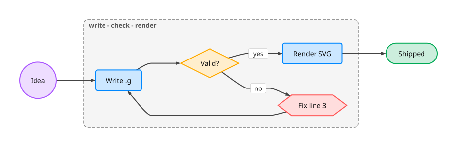

# @glypho/cli

<p>
  <a href="https://www.npmjs.com/package/@glypho/cli"></a>
  <a href="https://github.com/glypho-dev/glypho/actions/workflows/ci.yml"></a>
  <a href="https://github.com/glypho-dev/glypho/blob/main/LICENSE"></a>
</p>

Command-line tool for [Glypho](https://glypho.dev) (`.g`) — validate, render, and convert graph diagrams.



## Install

```bash
npm install -g @glypho/cli
```

## Commands

### Validate

```bash
glypho check diagram.g              # human-readable validation
glypho check diagram.g --json       # machine-readable output
glypho check flow.mmd               # Mermaid and DOT are detected by extension
```

### Render

```bash
glypho render diagram.g             # → diagram.svg
glypho render diagram.g -f png      # → diagram.png
glypho render diagram.g -o out.svg  # custom output path
glypho render diagram.g -o out/diagram.png  # format follows the extension; out/ is created
glypho render flow.mmd              # Mermaid input → SVG
glypho render graph.dot -f png      # DOT input → PNG
glypho render diagram.g --width 800 --height 600
glypho render diagram.g -f png --scale 3
glypho render diagram.g -f png -b transparent  # transparent PNG (default is white)
glypho render diagram.g -b '#eee'              # SVG with background color
```

The output format follows the `-o` extension (`.svg` or `.png`); `-f` sets it explicitly and must agree with that extension. `render` creates missing output directories and refuses to overwrite its input file. `--width`/`--height` take positive integers, `--scale` a positive number.

### Preview

```bash
glypho render diagram.g -o diagram.svg
glypho preview diagram.svg          # open an existing SVG in browser
glypho preview diagram.svg --force  # allow GUI side effects in CI/non-interactive runs
```

### Convert

```bash
# .g → text formats
glypho to mermaid diagram.g         # print Mermaid to stdout

# other formats → .g
glypho from mermaid flow.mmd        # print .g to stdout
glypho from dot graph.dot           # print .g to stdout
```

### Inspect

```bash
glypho parse diagram.g              # print JSON AST
glypho parse diagram.g --compact    # minified JSON
glypho info diagram.g               # stats + token comparison
glypho info diagram.g --json        # machine-readable stats
```

## Piping

Commands accept `-` for stdin, and if no file is given they read from stdin when input is piped. Stdin is read as `.g`; pass `--from mermaid` or `--from dot` to `check`, `parse`, `info`, `render` or `to mermaid` for other formats. Empty input is an error.

```bash
echo 'a > b > c' | glypho check
printf 'a:c A\nb:p B\na > b\n' | glypho render -o pipe.svg
echo 'a > b' | glypho to mermaid
cat flow.mmd | glypho from mermaid
cat flow.mmd | glypho check --from mermaid
cat graph.dot | glypho render --from dot -o graph.png
```

`render` is the only file-producing conversion command. Use `to` / `from` for text format conversion, use `render` for SVG or PNG output, and use `preview` only to open an existing SVG.

## Token Comparison

`glypho info` shows how `.g` compares to other formats:

```console
$ glypho info idea-to-ship.g
idea-to-ship.g
  Nodes: 5   Edges: 5   Groups: 1

  Format        Tokens
  .g                59
  Mermaid           96  (1.6x)
  Graphviz DOT     134  (2.3x)
  JSON Canvas      457  (7.7x)
```

## License

MIT
